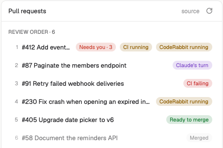

# PR Review Loop for Herdr

A [Herdr](https://herdr.dev) panel that shows the pull requests of the focused space in review order and whose turn each one is: yours, Claude's, CI's or CodeRabbit's. It reads the `pr-status.json` written by the [`pr-review-loop`](https://github.com/baruchiro/skills) Claude Code plugin, and lists the PRs that Claude sessions in the space opened.



## Install

Ask the agent in your Herdr home (`~/.config/herdr-app`) to add `herdr.dev/mods/baruchiro/herdr-pr-review-loop`, or do it by hand:

1. Copy `mods/pr-review-loop/` to `~/.config/herdr-app/mods/`.
2. Put the mod in a layout block, for example as a child of a stack: `{ "id": "prs", "type": "block", "content": { "mod": "pr-review-loop" } }`.
3. Run `herdr-app check ~/.config/herdr-app/mods/pr-review-loop`.

Requirements: [`gh`](https://cli.github.com/) (logged in), [`jq`](https://jqlang.github.io/jq/), and the plugin:

```sh
claude plugin marketplace add baruchiro/skills && claude plugin install pr-review-loop@skills
```

The mod runs programs: `bash`, the plugin's `pr-status.sh` (which calls the GitHub API through `gh`) and `git`.

### PRs opened by Claude sessions

`mods/pr-review-loop/hooks/record-session-prs.sh` is a Claude Code `PostToolUse` hook. It logs each PR a session creates, with the Herdr terminal it ran in, to `~/.local/state/claude-session-prs.jsonl`. Register it in `~/.claude/settings.json`:

```json
"hooks": {
  "PostToolUse": [
    { "matcher": "Bash|.*create_pull_request.*",
      "hooks": [{ "type": "command", "command": "bash ~/.config/herdr-app/mods/pr-review-loop/hooks/record-session-prs.sh" }] }
  ]
}
```

## Options

Block `props`, all optional: `refreshSeconds` (default `300`, `0` turns automatic refresh off), `script` (absolute path to `pr-status.sh`; empty finds the installed plugin), `sessionLog` (default `~/.local/state/claude-session-prs.jsonl`).

The panel publishes the number of PRs waiting on you as shared `"pr-review-loop.needsYou"`, so a tab bar can show it.

See [RECIPE.md](RECIPE.md) for the full brief.
