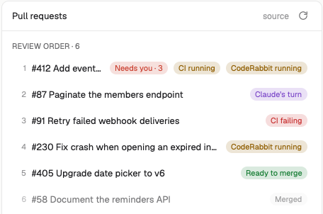

# PR Review Loop

A panel that shows the pull requests of the focused space in review order and whose turn each one is: yours, Claude's, CI's or CodeRabbit's. The data is the `pr-status.json` written by the [`pr-review-loop`](https://github.com/baruchiro/skills) Claude Code plugin, plus the PRs that Claude sessions in the space opened. It is a port of the [PR Review Loop VS Code extension](https://github.com/baruchiro/pr-status-vscode).



## What you see

Top to bottom, in one rounded card (radius 10, `background`, 1px `border`):

- **Header**, 42px: "Pull requests", the space's name in `dim` on the right, then a 24px refresh button. Its icon spins while a refresh runs.
- **Review order · N**: one list per `pr-status.json` found. When there is more than one list, the folder name appears on the right of the heading. Each row shows its position, `#number title` (truncated) and pills. Merged and closed rows are dimmed to 60%. A click expands the row to show the hint, the local-changes line, meta pills and the two buttons. A file with bad JSON shows the error above its list and keeps the last good data.
- **Opened in this space · N**: PRs that Claude sessions in this space opened and that are not in any `pr-status.json`, newest first, with the same rows.
- **Footer**: "Updated 3m ago". When needed it adds "auto refresh off", "refresh off: pr-review-loop skill not found" with an **Install** link, or the refresh error in `ansi1` with a **Retry** link.

Pills are 18px high, 11px text, with a 16% tint of their color as background:

| Status (`status` after the colon) | Label | Color |
|---|---|---|
| `needs-you` | Needs you · threads | `blocked` |
| `needs-agent` | Claude's turn | `ansi5` |
| `ci-failing` | CI failing | `ansi1` |
| `cr-pending` | CodeRabbit running | `ansi3` |
| `ci-pending` | Waiting | `muted` |
| `cr-not-triggered`, `cr-no-activity` | Check CodeRabbit | `ansi3` |
| `ready` | Ready to merge | `ansi2` |
| `clean` | Draft · review it | `muted` |
| `merged`, `closed` | Merged, Closed | `muted` |

Extra pills: "CI running" (`ci: pending`), "CodeRabbit running" (`cr: running`, unless the status already says it), and "Local changes" (`ansi5`). Meta pills: Draft, `repo → base`, file count.

## How it behaves

- **Which files:** the focused space's terminal folders, the folders its Claude sessions ran in, and the space's folder. From each one, the mod walks up to (not including) the home folder and takes the nearest `pr-status.json`. Spaces on other machines show a note instead.
- **Live file:** every 5 s the mod reads each file again and redraws on change, so the panel follows Claude rewriting it.
- **Refresh:** while the window is active, the mod runs the skill's `pr-status.sh` for a file's PRs when the file is older than `refreshSeconds` (default 300). It catches up when the window becomes active again. The output replaces `pr-status.json` and `pr-status.md` by rename. If the file changed while the script ran, the result is discarded. The refresh button forces a run.
- **Session PRs** are classified by the same script into the mod's own cache (`localStorage`); the project folders are not touched. Merged and closed PRs are not queried again.
- **Local changes:** every 15 s, for each git repo the space's terminals are in, a PR gets the pill when its repo's GitHub remote matches and either its head branch is checked out with uncommitted files, or its head branch has unpushed commits.
- **Count:** the number of PRs with `next: "you"` and no local changes is published as shared `"pr-review-loop.needsYou"`. A tab bar can show it on its PRs button.
- The agent statuses of Herdr (working, blocked, done, idle) are not used.

## Built from

- One mod, `mods/pr-review-loop/`, in a layout block: `{ "mod": "pr-review-loop", "props": { ... } }`. Optional props:
  - `refreshSeconds`: seconds between refreshes, `0` turns automatic refresh off. Default `300`.
  - `script`: absolute path to `pr-status.sh`. Empty: found through `~/.claude/plugins/installed_plugins.json` (`pr-review-loop@*`, then `baruchiro@*`).
  - `sessionLog`: the log of PRs that sessions opened. Default `~/.local/state/claude-session-prs.jsonl`.
- `model.js`: pills, `countNeedsYou`, `findScript`, `prSpecs`, `parseRemote`, `localChangesFor`, `ancestors`.
- `refresh.sh SCRIPT JSON_TARGET LINKS_FILE SPEC...` runs `pr-status.sh` with `PR_STATUS_FILE`, `PR_STATUS_JSON_FILE` and `PR_REVIEW_LINKS_FILE`. `JSON_TARGET` `-` prints the JSON instead.
- `herdr`: `spaces`, `panes`, `focused`, `readTextFile`, `exec` (`bash`, `git`, `open`/`xdg-open`), `setShared`, `run("tab.new")` for Install, `window().active`.
- `hooks/record-session-prs.sh`: a Claude Code `PostToolUse` hook. It appends `{url, terminal, session, cwd, at}` for each PR URL in the output of `gh pr create` or a GitHub MCP `create_pull_request`. `terminal` is `$HC_TERMINAL_ID`, which maps the PR to its Herdr space. Register it in `~/.claude/settings.json`:

  ```json
  "PostToolUse": [{ "matcher": "Bash|.*create_pull_request.*", "hooks": [{ "type": "command", "command": "bash ~/.config/herdr-app/mods/pr-review-loop/hooks/record-session-prs.sh" }] }]
  ```
- Icons: `pr.svg`, `refresh.svg`.

## Watch out

- The mod runs programs: `bash refresh.sh`, which runs `pr-status.sh`, which calls `gh api graphql`. It also runs `git`. It needs `gh` (logged in) and `jq`.
- `pr-status.sh` fails the whole batch when one PR can't be read. The footer then shows that error.
- `pr-status.sh` reads an empty links file as invalid JSON. `refresh.sh` passes a missing file instead.
- `window()` is null during `herdr-app check`. Guard it.
- The hook fires on any `Bash` call whose command contains `gh pr create`, even inside a test, and logs every PR URL in the output. Test it with a separate `HOME`.
- Open only `https://github.com/` URLs, without a shell: `open`, `xdg-open`, or on Windows `rundll32 url.dll,FileProtocolHandler`. `cmd /c start` would run anything after an `&` in a URL.
- `line_height` takes a string with a unit (`"18px"`). A bare number is a multiplier of the text size, so `18` spreads a hint over the whole panel.
- A mod copy starts the first time its block shows. Until the panel is opened once, the needs-you count is not published.
- Only repos where the space's terminals are get the local-changes check. Session PRs belong to the space their terminal was in. The mod remembers each terminal's space (`localStorage`), so a closed session's PRs stay. A terminal the mod never saw counts for a space whose folder, or one of whose terminal folders, is the session's `cwd`.

## Done when

- `herdr-app check mods/pr-review-loop` passes.
- In a space whose terminal is inside a folder with `pr-status.json`, the panel lists its PRs in file order with the pills above.
- Editing that file changes the panel within 5 s.
- The refresh button spins, and afterwards `generatedAt` in the file is new.
- After `gh pr create` in a Claude session in the space (hook registered), the PR appears under "Opened in this space" with pills.
- With the plugin uninstalled, the footer offers Install.
